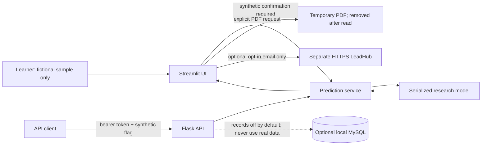

# VitalCue architecture

**As-is review:** 2026-11-17. This describes the checked repository, not a claim that its public deployment is healthy. The playbook records the Render route as HTTP 503; it has not been rechecked in this task.

## Current boundaries

- **Streamlit UI (`app.py`)** owns the fictional-sample form, explicit synthetic-data confirmation, visible warning, optional PDF request, and optional LeadHub email signup.
- **Prediction service (`app/services/health_service.py`)** calls the model evaluator and only runs persistence, PDF generation, or email when requested. The Streamlit storage/email controls are hidden by default and gated by `AGEWELL_LOCAL_STORAGE_ENABLED`; the optional API has separate auth/config gates.
- **Model (`app/models/predictor.py`)** loads a serialized scikit-learn artifact from `AGEWELL_MODEL_PATH`. Artifact provenance, training-data rights, validation evidence, and model card are not yet verified.
- **Optional Flask API (`app/routes/api.py`)** has health and prediction endpoints. Prediction requests require a bearer token and an explicit synthetic-data flag. API persistence is disabled; record access has a separate opt-in setting and carries health data.
- **MySQL helper (`app/utils/db.py`)** is optional and is not configured for the hosted demo according to the repository docs. Do not enable it for a public workshop.
- **PDF helper** writes a temporary report; the Streamlit UI reads its bytes and removes the file, but bytes remain in session memory until reset/clear. Reports must remain fictional and should not be persisted or emailed.
- **LeadHub signup** is shown only for a configured HTTPS origin; the request sends email/consent/source/project identity, never model inputs or reports. The service is currently unconfigured, and its confirmation, unsubscribe, and suppression behavior has not been verified from this repo.

## Current data flow

The database line is a boundary/context note, not the normal prediction flow; API prediction does not save, even if a save flag is requested. Public hosting should keep database/email toggles off. There is no background queue, cache, or external model API today; adding one would increase cost and data exposure without serving the initial workshop.

## Data classification and retention

| Data | Current handling | Product rule |
|---|---|---|
| Fictional input values and outputs | Processed for a session; no persistence in the hosted demo | Never ask for, accept, or imply safe processing of real/identifiable health data |
| PDF bytes | Temporary file is removed after it is read; in-memory session bytes last until clear/reset/session end | Do not email, log, upload, or use real values; show clear/delete action |
| Signup email and consent | Optional separate LeadHub request only when configured | Require explicit opt-in; verify confirmation, unsubscribe, and suppression behavior with LeadHub before enabling; exclude all health fields |
| API token | Server environment variable; bearer auth | Keep server-side only; rotate if exposed; do not log it |
| Optional DB record | Disabled by default; may contain health measurements and model result | Keep local/isolated only; no public enablement without retention/access/security review |

## Operational gaps before any pilot release

- Render availability is not proven; current playbook records HTTP 503. Restore and smoke-test in the personal deployment before advertising a live demo.
- No synthetic-model provenance/model card, dataset rights decision, or independent evaluation is documented. Do not claim accuracy, clinical validity, bias performance, or a calibrated probability.
- There is no application-level auth for the public Streamlit demo. Keep it synthetic-only; do not add accounts until a real need and threat model justify them.
- No analytics, error-reporting provider, or backup/restore flow is verified. Avoid collecting health input in telemetry. A workshop pilot can measure attendance and instructor feedback manually without storing participant values.
- Email configuration and LeadHub endpoint are absent. Do not promise automated follow-up; only enable after sender, consent, confirmation, suppression, and unsubscribe behavior are verified.
- Health score and rule-based food/activity examples risk sounding prescriptive. Keep them framed as code-defined teaching examples; consider removing them from any promoted version unless they have a clear teaching rationale and strong safeguards.

## Target pilot shape

For the first paid test, prefer a single-user, facilitator-led delivery using the current monolith plus a prepared lesson kit. Keep predictions ephemeral and data fictional. A workshop uses a written scope, instructor-run demo, student worksheet, and debrief; the app is a demo component, not a health service. If online access remains unavailable, use an approved local package after verifying dependency/model licenses and setup steps.

Do not build a queue, caching layer, cloud database, multi-tenant auth, SSO, billing, or AI service before a buyer validates the need. Those components would add operational burden and health-data risk without evidence of demand. See [ADR 0001](adr/0001-education-only-workshop-boundary.md).
